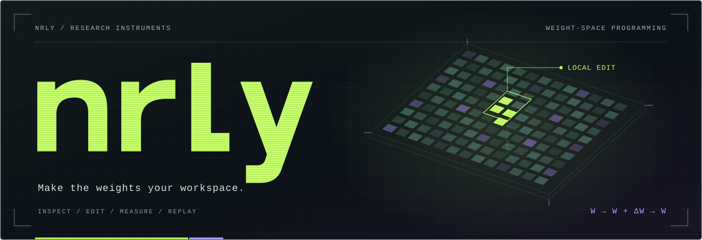

<p align="center">
  
</p>

<p align="center">
  <a href="#status--evidence"></a>
  <a href="#first-contact"></a>
  <a href="LICENSE"></a>
</p>

<p align="center">
  <strong>A local workbench for weight-space programming.</strong><br>
  Inspect neural-network parameters. Author exact edits. Measure what changes. Replay the evidence.
</p>

<p align="center">
  <a href="#first-contact">Quickstart</a> ·
  <a href="#write-a-weight-program">Write a program</a> ·
  <a href="#connect-your-tools">Connect your tools</a> ·
  <a href="docs/wave3.md">Field guide</a> ·
  <a href="#status--evidence">Evidence</a>
</p>

---

## Make the weights your workspace

What happens when you change the model itself?

nrly gives that question an executable form: a **weight program**, bound to an exact model, with recorded changes and a repeatable evaluation. Work directly with parameters, inspect activations and token probabilities, compare an edit against controls, and export a bundle someone else can run.

The ambition is a shared experimental language for weight-space programming. Today, nrly supplies the local instruments: a Python kernel, CLI, MCP server, and typed TypeScript client.

| Research question | Instrument |
| :--- | :--- |
| **What is actually in this tensor?** | Coordinate and slice reads, statistics, shapes, and hashes. |
| **What did my edit change?** | Recorded parameter deltas, selected activation captures, and continuation token probabilities. |
| **Does it beat a simpler intervention?** | Registered prompt or checkpoint comparators, paired seeds, and target/regression summaries. |
| **Did the next repair undo the first?** | Immutable edit ancestry and original → A → A+B comparisons. |
| **Can someone reproduce this?** | Exact model/runtime fingerprints, checksummed bundles, fresh execution, and portable patch programs. |

## First contact

Start with a small, real PyTorch network on the CPU. No model download or GPU is needed for this demo; setup installs Python dependencies, including PyTorch.

Requires Git, [uv](https://docs.astral.sh/uv/), and Python 3.12+. **Windows with Python 3.13 is the validated environment.** Install from the checkout while registry releases are being prepared:

```sh
git clone https://github.com/JMoak/nrly.git
cd nrly
uv sync --python 3.13 --extra torch
uv run --no-sync nrly doctor
uv run --no-sync nrly demo --export .nrly/first-contact
uv run --no-sync nrly replay .nrly/first-contact
```

The demo repairs a deliberately faulty sum network, evaluates six cases, and reruns the original model to check restoration. Expected results:

| Original | Edited | Restored |
| :---: | :---: | :---: |
| **1 / 6** correct | **6 / 6** correct | Original outputs match |

This is an engineering fixture with a known repair. It demonstrates the workflow; it does not establish a language-model capability improvement. Choose a new export directory on subsequent runs: existing bundles are never overwritten. Keep `--no-sync` on later commands to preserve the selected environment.

<details>
<summary><strong>Move to a Hugging Face model or NVIDIA GPU</strong></summary>

For Hugging Face execution, select `--extra hf` instead of `--extra torch`. On Windows with a compatible NVIDIA GPU, use the pinned CUDA 13.2 environment:

```sh
uv sync --python 3.13 --extra cuda
uv run --no-sync nrly doctor
```

The real-model acceptance uses **Qwen3-0.6B**, BF16, eager attention, and an RTX 5090. Recipes pin the checkpoint revision and default to local files. Follow the [model setup](docs/workbench-reference.md#real-model) before running them; CPU execution requires a CPU device/dtype in the model specification and has a different runtime fingerprint.

The [diagnosis guide](docs/diagnostics.md) explains continuation probabilities and activation captures. [Qwen evidence](docs/validation/wave3-qwen/README.md) records what was actually measured.

</details>

## Write a weight program

A program describes an edit to a particular model. The same validated representation travels through Python, the CLI, MCP, studies, and replay.

```python
from nrly.authoring import WeightProgram
from nrly.backends.tiny import TinyBackend
from nrly.contracts import CaseSpec, GenerationSpec, ModelSpec, ProgramSpec

case = CaseSpec(id="sum", input="[2,4]", expected="6", scorer="numeric")

with TinyBackend(ModelSpec()) as model:
    repair = (
        WeightProgram(model.identity.fingerprint)
        .scale("output.weight", 2)
        .build()
    )
    before = model.run_case(case, ProgramSpec(), [], GenerationSpec()).output
    edited = model.run_case(case, repair, [], GenerationSpec()).output
    after = model.run_case(case, ProgramSpec(), [], GenerationSpec()).output

print(before, edited, after)  # 3 6 3
```

**Inspect → apply → execute → restore → verify.** The edit is scoped to execution; source checkpoints stay intact. The saved program preserves the intervention so it can be run again.

Compose sparse patches, scaling, dense/sparse additions, or low-rank updates. Python helpers compile direction removal and rank-one calculations into declarative operations. Record ancestry, check whether successive edits interfere, and export a patch pinned to its base model.

Read [authoring and reusable patches](docs/authoring.md), the [operation reference](docs/workbench-reference.md#inspect-edit-compare), or the [example recipes](recipes).

## Make the experiment answerable

An edited output is the start of an investigation. nrly can register controls, prompt or checkpoint comparators, sampling seeds, evaluation cases, and cumulative budgets before candidate submission. Finalization freezes one candidate for evaluation against a separately supplied holdout.

Each attempt remains in the record. Failed, interrupted, truncated, and unscored cases cannot become passes. Target improvements and regressions are reported separately; a completed run can still produce an inconclusive result.

- **Diagnose:** inspect the token probabilities of a supplied continuation and capture selected activations. These observations are separate from generated-answer accuracy.
- **Compare:** evaluate the original, controls, and candidate on registered cases and seeds.
- **Review:** generate an offline HTML report, inspect edit lineage, and retain unsuccessful attempts.
- **Share:** export the program, specification, results, and integrity manifest. Model weights are referenced, not bundled.

[Controlled study walkthrough](docs/workbench-reference.md#controlled-discovery-studies) · [Scoring and comparison rules](docs/evaluation.md) · [Current workflows](docs/wave3.md)

## Connect your tools

```text
  Python authoring          CLI          MCP / TypeScript
         │                   │                  │
         └─────────── validated contracts ───────┘
                             │
                    application + studies
                             │
                      isolated runner ───── evidence store
                             │
                       PyTorch kernel
                inspect → edit → run → restore
```

The CLI and MCP server share the same application operations. The trusted local Python adapter also supports caller-owned PyTorch models directly; that in-process path does not use the isolated runner.

Start the **26-tool MCP server** from the configured checkout:

```sh
uv run --no-sync python -m nrly.mcp --root .nrly/agent --model-cache .cache/models
```

When another application launches the server, configure absolute interpreter and workspace paths. The [TypeScript client](packages/client/README.md) provides typed run/study handles, pagination, deadlines, and adapters for **Keywork**, **Vibrissa**, and other MCP clients. It is currently built from source. The Python kernel remains independent of those applications.

Read [MCP execution semantics](docs/workbench-reference.md#agent-interface) and the [integration map](docs/repo-integrations.md). Optional public study-context export supports CorePack-AI's UCP `.ai` layout; see the [UCP assessment](docs/research/ucp-assessment.md).

## Status & evidence

**Experimental · Python `0.3.0a1` · TypeScript `0.3.0-alpha.1`**

The [10 November 2026 acceptance record](docs/validation/wave3-2026-11-10.md) includes **377 Python tests**, **22 SDK tests**, live MCP checks, the actual Keywork connector, and real Qwen GPU execution. Python wheel/source archives were inspected, and the wheel was exercised outside the checkout using existing dependencies.

On Qwen, nrly recorded **16,384 changed parameter values**, nonempty probability and activation evidence, exact restoration, and successful replay. The sampled study's final verdict was **inconclusive / retain the original**. That establishes working instrumentation, not a useful model repair.

The next research milestone is a repair that beats matched controls on independently prepared held-out cases. Autonomous editor synthesis, quantized/tied-weight editing, merged-checkpoint export, and a hosted community registry remain future work. The [research audit](docs/research-audit.md) explains the foundations and open questions.

### Operating envelope

nrly is built for **trusted local research**. Hugging Face loading requires safetensors and disables remote code. It is not an authenticated multi-user service or an arbitrary-code sandbox. The holdout boundary is enforced by the application; filesystem access can bypass it.

Programs are bounded to 32 operations and 65,536 inline values. Distinct edited tensor storage is capped at 512 MiB; this is not a total-memory limit. Full-state restoration checks cost time proportional to model size. Replay checks exact identities; cross-device or cross-version determinism is not promised.

Read the [security policy](SECURITY.md) and [evidence semantics](docs/workbench-reference.md#evidence-and-architecture) before connecting agents or sharing artifacts.

## Build with us

Useful contributions start with an experiment: a reproducible failure, an independently evaluated edit, a model adapter, or a clearer way to inspect the evidence. Include the model revision, runtime, recipe, controls, and observed result. Keep private datasets, credentials, and model weights out of issues and bundles.

```sh
uv run --no-sync pytest
uv run --no-sync ruff check .
uv run --no-sync mypy
uv run --no-sync python scripts/check_publication.py
bun install --frozen-lockfile
bun run test:client
bun run test:mcp
```

GPU/model-download checks are separate. The optional `bun run test:keywork` additionally requires `KEYWORK_REPO` pointing to an existing Keywork checkout. See [engineering conventions](AGENTS.md) before changing contracts or execution semantics.

---

<p align="center">
  <strong>Small edits. Explicit evidence. Open questions.</strong><br>
  <sub>nrly · pronounced “neural-y” / “gnarly” · <a href="LICENSE">MIT</a></sub>
</p>
